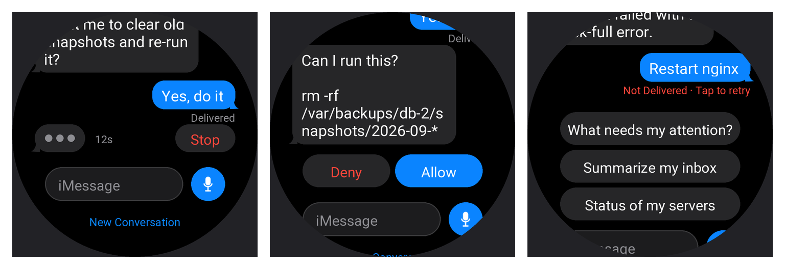

<p align="center"></p>

<h1 align="center">Hermes for Amazfit</h1>

<p align="center">Message your <a href="https://hermes-agent.nousresearch.com/">Hermes agent</a> from your wrist,
in an iMessage-style chat.<br>Dictate or type, tap a smart reply, allow what it wants to run, and read its replies on your watch.</p>

<p align="center"></p>
<p align="center"></p>

## What it does

- **A real conversation**, like Messages on Apple Watch: your messages in blue, your agent's in
  gray, timestamps, "Delivered", and a typing indicator while it works (with **Stop**).
- **Dictate** with the blue mic button or **type** in the iMessage field.
- **Smart replies**: one-tap messages you set on your phone.
- **Allow / Deny** right in the chat when your agent wants to run a command, and answer its questions.
- **Your agent's name and photo** in the header (see [Make it yours](#make-it-yours)).
- **Not Delivered · Tap to retry** when your phone or server is unreachable.
- The conversation is kept on the watch, so reopening the app picks up where you left off.
- Your **API key stays on your phone**. The watch never sees it.

```
Watch ──Bluetooth──▶ Zepp app on your phone ──HTTPS──▶ your Hermes API server
```

## What you need

- An **Amazfit watch with Zepp OS 3 or newer**, round or square (see [Supported watches](#supported-watches)).
- The **Zepp app** on your phone, with the watch paired.
- A **computer** with [Node.js](https://nodejs.org) 18 or newer (only for installing).
- A free **Zepp developer account**: sign up at [console.zepp.com](https://console.zepp.com).
- A running **Hermes agent** on a server or computer.

## Set up Hermes (once)

Hermes needs its API server turned on and reachable over HTTPS. You don't have to do this by hand:
**copy the prompt in [HERMES_SETUP.md](HERMES_SETUP.md) and send it to your Hermes agent.** It
sets everything up, tests it, and replies with your **Server URL** and **API key**. Keep that reply;
you'll need it in step 7.

## Install on your watch

**1. Install the Zeus CLI** (Zepp's developer tool) and log in with your Zepp developer account:

```sh
npm install -g @zeppos/zeus-cli
zeus login
```

**2. Download this app and open the folder in a terminal**, then run `zeus preview`:

```sh
git clone https://github.com/muhammedilyasy/hermes-amazfit.git
cd hermes-amazfit
npm install
zeus preview
```

**3. Select your watch model** when asked (e.g. **Amazfit Bip 6**). A QR code appears in the terminal.

**4. Turn on Developer Mode in the Zepp app:** Profile → Settings → About, then tap the Zepp icon
**7 times** until a pop-up confirms it.

**5. Scan the QR code from the Zepp app:** Profile → Developer Mode → **Scan**, and scan the code in
your terminal. The app installs on your watch.

**6. Open the app's settings:** in the Zepp app, go to **Device → General → Developer settings →
Add mini app**, then open **Hermes** and its **Settings**.

**7. Enter your Hermes API endpoint** in **Server URL**, e.g. `https://hermes.example.com`.

**8. Enter your API key** (the `API_SERVER_KEY` Hermes gave you), then tap **Test connection**.
It should say **Connected · Hermes x.y.z**.

<p align="center"></p>

**9. Use it.** Open **Hermes** on your watch. Under the name it says **Online**. Tap the mic to
dictate, the **iMessage** field to type, or a smart reply.

> Keep the Zepp app running in the background on your phone: the watch talks to Hermes through it.

## Make it yours

Give your agent its own name and picture (shown in the watch header, as the app icon, and in the
phone settings):

```sh
pip3 install pillow
python3 tools/gen-assets.py --name "Maximus" --photo ~/Pictures/maximus.jpg
zeus preview
```

Use `--crop x0,y0,x1,y1` to pick the square of the photo to use (default: centered). Without
`--photo` you get iMessage-style initials. You can also change just the name in the phone settings
(**Contact → Name**).

## Supported watches

Works on every Amazfit watch that runs **Zepp OS 3 or newer**, round and square.

| Watch | What you get |
| --- | --- |
| **Zepp OS 4+**: Bip 6, Bip Max, Active 2 (round & square), Active 3 Premium, Active Max, Balance 2, Balance 3, Balance Ultra, T-Rex 3, T-Rex 3 Pro, T-Rex Ultra 2, Cheetah 2 Pro, Cheetah 2 Ultra | Everything: dictation, typing, smart replies |
| **Zepp OS 3.x**: Active, Active Edge, Balance, Bip 5 Unity, Cheetah, Cheetah Pro, Cheetah Square, Falcon, GTR 4, GTS 4, T-Rex Ultra | Smart replies, typing indicator, Stop, Allow/Deny (no dictation or typing: these watches have no system keyboard) |
| Older: GTR 3 / 3 Pro, GTS 3, GTS 4 mini, Band 7, Bip 5, GTR Mini, T-Rex 2 | Not supported (Zepp OS 1.x / 2.x can't run this app) |

Tested on a real **Bip 6**; the other watches are checked with screen previews, not on the device.
Update your watch to the latest firmware for the best result.

## Troubleshooting

| What you see | Fix |
| --- | --- |
| `zeus preview` complains about the app ID | Create an app at [console.zepp.com](https://console.zepp.com) and put its ID in `appId` in `app.json`. |
| Header says **Set up in the Zepp app** | Enter the Server URL and API key in the app's Settings in the Zepp app (steps 6–8). |
| **Phone not connected** / **Not Delivered** | Open the Zepp app on your phone and keep Bluetooth on, then tap the message to retry. |
| `API key rejected (401)` | The key doesn't match `API_SERVER_KEY` on your server. Paste it again. |
| `Blocked by Cloudflare (403)` | Cloudflare's bot protection is blocking the phone. See [HERMES_SETUP.md](HERMES_SETUP.md#troubleshooting). |
| `Hermes or tunnel is down` | Restart the Hermes gateway and your tunnel. |
| The mic doesn't open dictation | Tap the **iMessage** field to type instead; dictation depends on your watch firmware. |

## Security

Hermes' API server can run anything Hermes can, including terminal commands. The setup prompt keeps
Hermes bound to `127.0.0.1` behind an HTTPS tunnel, and every request needs your API key. Don't
share the key. If it leaks, ask Hermes to generate a new `API_SERVER_KEY` and update it in the app.

## Development

```sh
npm install
zeus dev                                                          # run in the Zepp OS simulator
node --import ./tools/preview/register.mjs tools/check.mjs        # layout / import checks
node --import ./tools/preview/register.mjs tools/test-side.mjs    # phone side vs. a fake Hermes
python3 tools/preview/shots.py                                    # render every watch screen
sh tools/preview/settings.sh                                      # render the phone Settings page
python3 tools/gen-assets.py                                       # regenerate images (bubble tails, mic, avatar, icon)
```

`shots.py` needs Pillow and the Noto Sans font (`sh tools/preview/setup.sh` once). `settings.sh`
needs Google Chrome. Code layout and conventions are in [CLAUDE.md](CLAUDE.md).

## Credits

- Built on [Zepp OS](https://docs.zepp.com) and [ZML](https://github.com/zepp-health/zml).
- [Hermes Agent](https://hermes-agent.nousresearch.com/) by Nous Research. This is an unofficial
  community app, not affiliated with Nous Research, Zepp Health, or Anthropic.
- UI modeled on Messages for Apple Watch. Not affiliated with Apple; iMessage is a trademark of Apple Inc.

## License

[MIT](LICENSE)
