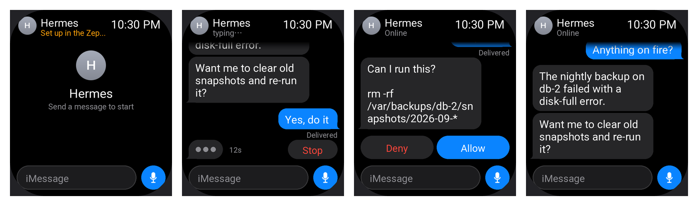
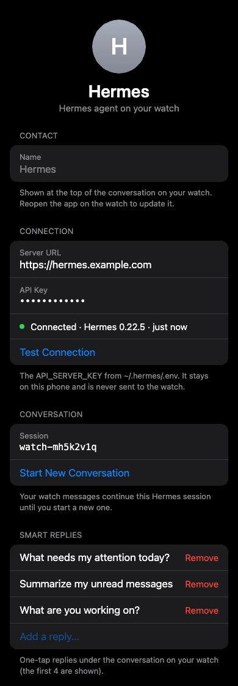

<p align="center"></p>

<h1 align="center">Hermes for Amazfit</h1>

<p align="center">Talk to your <a href="https://hermes-agent.nousresearch.com/">Hermes agent</a> from your wrist.<br>
Ask by voice, tap a quick command, approve what it wants to run, and read the reply on your watch.</p>

<p align="center"></p>

## What it does

- **Ask by voice or keyboard**, or tap one of up to 8 **quick commands** you set on your phone.
- **Live status** while Hermes works ("Working · 12s") with a **Stop** button.
- **Approve / Deny** when Hermes wants to run a command, and answer its questions.
- **Reply** to keep the same conversation going, or start a new one.
- **Reopen the last reply** if the screen went off while Hermes was working.
- Your **API key stays on your phone**. The watch never sees it.

```
Watch ──Bluetooth──▶ Zepp app on your phone ──HTTPS──▶ your Hermes API server
```

## What you need

- An **Amazfit Bip 6** (Zepp OS 4.x). Other watches aren't supported yet; the Active 2 (Square) has
  the same screen and may work, but it's untested.
- The **Zepp app** on your phone, with the watch paired.
- A **computer** with [Node.js](https://nodejs.org) 18 or newer (only for installing).
- A free **Zepp developer account**: sign up at [console.zepp.com](https://console.zepp.com).
- A running **Hermes agent** on a server or computer.

## Set up Hermes (once)

Hermes needs its API server turned on and reachable over HTTPS. You don't have to do this by hand:
**copy the prompt in [HERMES_SETUP.md](HERMES_SETUP.md) and send it to your Hermes agent.** It
sets everything up, tests it, and replies with your **Server URL** and **API key**. Keep that reply;
you'll need it in step 7.

## Install on your watch

**1. Install the Zeus CLI** (Zepp's developer tool) and log in with your Zepp developer account:

```sh
npm install -g @zeppos/zeus-cli
zeus login
```

**2. Download this app and open the folder in a terminal**, then run `zeus preview`:

```sh
git clone https://github.com/muhammedilyasy/hermes-amazfit.git
cd hermes-amazfit
npm install
zeus preview
```

**3. Select your watch model** when asked (**Amazfit Bip 6**). A QR code appears in the terminal.

**4. Turn on Developer Mode in the Zepp app:** Profile → Settings → About, then tap the Zepp icon
**7 times** until a pop-up confirms it.

**5. Scan the QR code from the Zepp app:** Profile → Developer Mode → **Scan**, and scan the code in
your terminal. The app installs on your watch.

**6. Open the app's settings:** in the Zepp app, go to **Device → General → Developer settings →
Add mini app**, then open **Hermes** and its **Settings**.

**7. Enter your Hermes API endpoint** in **Server URL**, e.g. `https://hermes.example.com`.

**8. Enter your API key** (the `API_SERVER_KEY` Hermes gave you), then tap **Test connection**.
It should say **Connected · Hermes x.y.z**.

<p align="center"></p>

**9. Use it.** Open **Hermes** on your watch. The header shows a green **Online**. Tap **Ask by
voice**, **Type**, or a quick command.

> Keep the Zepp app running in the background on your phone: the watch talks to Hermes through it.

## Troubleshooting

| What you see | Fix |
| --- | --- |
| `zeus preview` complains about the app ID | Create an app at [console.zepp.com](https://console.zepp.com) and put its ID in `appId` in `app.json`. |
| Watch header says **Set up** | Enter the Server URL and API key in the app's Settings in the Zepp app (steps 6–8). |
| **No phone** | Open the Zepp app on your phone and keep Bluetooth on. |
| `API key rejected (401)` | The key doesn't match `API_SERVER_KEY` on your server. Paste it again. |
| `Blocked by Cloudflare (403)` | Cloudflare's bot protection is blocking the phone. See [HERMES_SETUP.md](HERMES_SETUP.md#troubleshooting). |
| `Hermes or tunnel is down` | Restart the Hermes gateway and your tunnel. |
| Voice input doesn't open | Use **Type** instead; voice depends on your watch firmware. |

## Security

Hermes' API server can run anything Hermes can, including terminal commands. The setup prompt keeps
Hermes bound to `127.0.0.1` behind an HTTPS tunnel, and every request needs your API key. Don't
share the key. If it leaks, ask Hermes to generate a new `API_SERVER_KEY` and update it in the app.

## Development

```sh
npm install
zeus dev                                                          # run in the Zepp OS simulator
node --import ./tools/preview/register.mjs tools/check.mjs        # layout / import checks
node --import ./tools/preview/register.mjs tools/test-side.mjs    # phone side vs. a fake Hermes
python3 tools/preview/shots.py                                    # render every watch screen
sh tools/preview/settings.sh                                      # render the phone Settings page
python3 tools/gen-icon.py                                         # regenerate the pixel logo
```

`shots.py` needs Pillow and the Noto Sans font (`sh tools/preview/setup.sh` once). `settings.sh`
needs Google Chrome. Code layout and conventions are in [CLAUDE.md](CLAUDE.md).

## Credits

- Built on [Zepp OS](https://docs.zepp.com) and [ZML](https://github.com/zepp-health/zml).
- [Hermes Agent](https://hermes-agent.nousresearch.com/) by Nous Research. This is an unofficial
  community app, not affiliated with Nous Research, Zepp Health, or Anthropic.
- UI inspired by [resend.com](https://resend.com). Pixel font: [Silkscreen](https://github.com/googlefonts/silkscreen)
  (SIL Open Font License 1.1, see [LICENSES/](LICENSES/)).

## License

[MIT](LICENSE)
